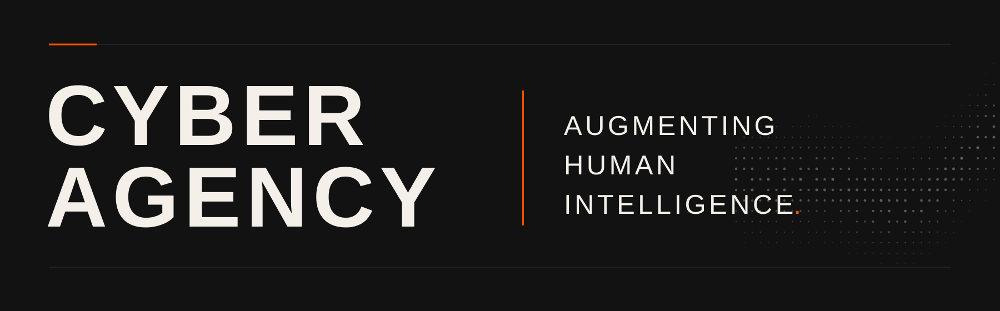

<picture>
  <source media="(prefers-color-scheme: dark)" srcset="./assets/profile-dark.svg">
  <source media="(prefers-color-scheme: light)" srcset="./assets/profile-light.svg">
  
</picture>

 

## The world does not come with a brief.

Cyber Agency helps companies, private capital, and institutions understand complex environments, make consequential decisions, and build the products, systems, and teams those decisions require.

We connect intelligence, technology, and execution across work that does not fit neatly within one discipline.

 

|  | PRACTICE | SCOPE |
|:--|:--|:--|
| **01** | **Intelligence & Strategy** | Research, competitive and market intelligence, diligence, venture and commercial strategy. |
| **02** | **AI, Product & Engineering** | AI agents, private AI, product development, software, infrastructure, and systems integration. |
| **03** | **Security & Resilience** | Cybersecurity, technical hardening, web and cloud infrastructure, recovery, and resilience. |
| **04** | **Leadership & Talent** | Fractional leadership, specialists, engineering teams, and capability development. |

 

**[Website](https://cyberagency.org)** &nbsp; / &nbsp; **[Contact](mailto:brad@cyberagency.org)** &nbsp; / &nbsp; **[Venture Method](https://github.com/cyberagencyorg/venturemethod)**

