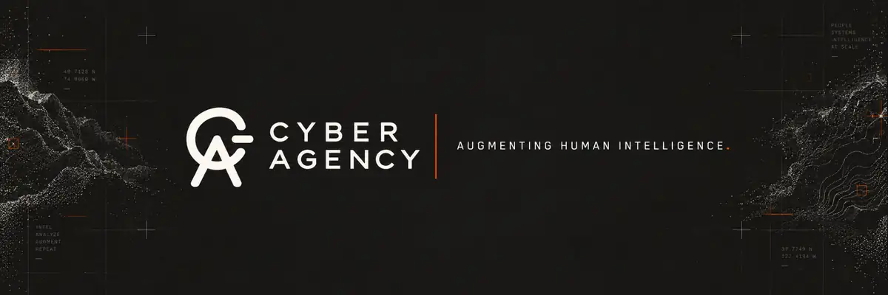

  

  

    <a href="https://cyberagency.org"><strong>WEBSITE</strong></a>
    &nbsp;&nbsp; / &nbsp;&nbsp;
    <a href="mailto:brad@cyberagency.org"><strong>INQUIRIES</strong></a>
  

 

## The world does not come with a brief.

Cyber Agency is an applied intelligence and technology firm working with companies, private capital, and institutions on problems that cross disciplines.

We connect research and strategy with product development, intelligent systems, security, and specialist leadership. The engagement can begin with a question, a product, an existing system, or a problem that has never fit neatly within a single function.

 

### Practices

| | | |
|:--|:--|:--|
| `01` | **Intelligence** | Strategic research, market and competitive intelligence, foresight, diligence, and capital intelligence. |
| `02` | **Product** | Product and venture strategy, software and AI-native product development, design, and modernization. |
| `03` | **Systems** | Private AI, agents, organizational knowledge systems, engineering, integration, cybersecurity, and resilience. |
| `04` | **Leadership & Teams** | Fractional leadership, specialist teams, technical talent, and organizational capability development. |

 

### How we engage

**Advisory** &nbsp; / &nbsp; **Build** &nbsp; / &nbsp; **Embedded** &nbsp; / &nbsp; **Managed**

 

---

  <a href="https://cyberagency.org"><strong>cyberagency.org</strong></a>
  &nbsp; &nbsp;
  <a href="mailto:brad@cyberagency.org">brad@cyberagency.org</a>

